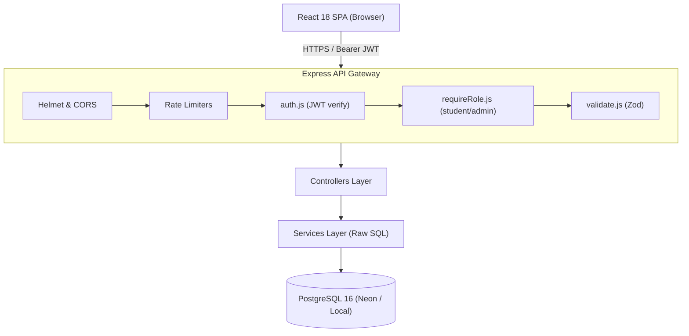
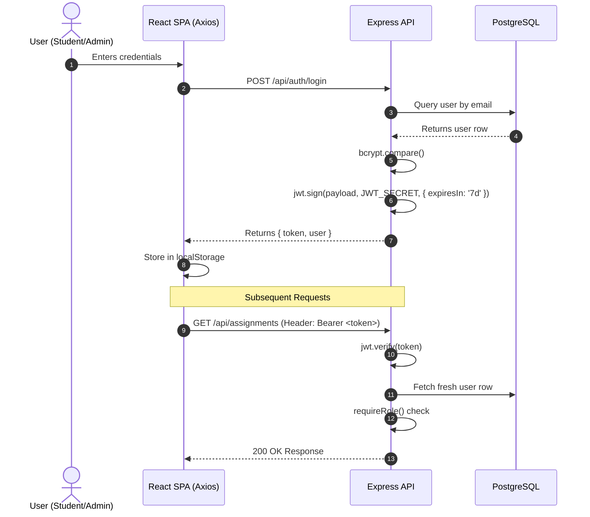
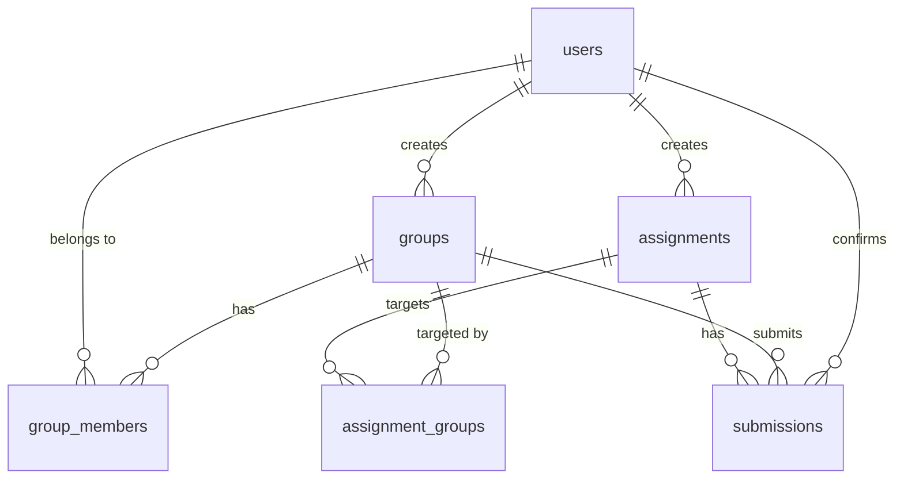

# JoinEazy Assignment Manager

A full-stack, role-based Student, Group & Assignment Management System engineered for university courses. Built with strict role segregation, atomic team submissions, real-time analytics, and raw SQL queries over PostgreSQL.

[](https://nodejs.org/)
[](https://react.dev/)
[](https://tailwindcss.com/)
[](https://www.postgresql.org/)
[](https://opensource.org/licenses/MIT)

---

## 1. Overview & Features

### 🎓 Student Role
- **Account & Profile**: Register with university email and optional Student ID; login with JWT token persistence.
- **Group Management**:
  - Create **ONE** group (automatically designated as Group Leader).
  - Add members by university email or Student ID (leader only).
  - Remove members with instant cascade updates (leader only).
  - Delete group when sole member (leader only; prevented if others are in the group).
- **Targeted Assignments**:
  - View all assignments targeted at their specific group or broadcast to all students.
  - Direct access to designated OneDrive deliverable folders in a new browser tab.
  - Visual status badges: `⏳ Pending`, `✓ Submitted`, and `⚠ Overdue`.
- **Two-Step Submission Flow**:
  - Step 1: Click "Yes, I have submitted".
  - Step 2: Confirmation modal dialog ("Confirm submission for `<group>`? This cannot be undone.") prevents accidental submissions.
  - Submissions are recorded per group by any member with timestamp and user audit trail.
- **Visual Progress Tracking**:
  - Real-time progress bar displaying percentage and completed assignments ratio ($X/Y$).
  - Color-coded deadline countdown indicators (`Due in 3d 4h`, `Overdue by 2d`).

### 👨‍🏫 Admin (Professor) Role
- **Assignment Management (Full CRUD)**:
  - Create assignments with title, description, deadline, and HTTPS OneDrive repository URL.
  - Flexible targeting: Broadcast to **All Students** or restrict to **Specific Groups** via multi-select.
  - Edit deadlines, links, and target groups with atomic transaction rollback.
  - Delete assignments with cascading cleanup of submissions.
- **Submission Tracking (Dual-View)**:
  - **Group-Wise Tab**: Table displaying every targeted team, submission status badge, confirming student, and exact confirmation timestamp.
  - **Student-Wise Tab**: Detailed student roster breakdown displaying student name, email, ID, team membership, member role (`Leader`/`Member`), status badge, and submission details.
  - Instant search filtering and status pill tabs (`All`, `Submitted`, `Pending`, `Overdue`).
- **Interactive Analytics Dashboard**:
  - High-level KPI summary cards (Total Students, Active Groups, Total Assignments, Submissions Recorded).
  - **Recharts Visualizations**:
    - **Completion Donut**: Overall submission percentage across expected team deliverables.
    - **Per-Assignment Bar Chart**: Completion percentage across all active assignments.
    - **Per-Group Bar Chart**: Submission completion rates per team to identify struggling groups.

---

## 2. Tech Stack

| Domain | Technologies Used |
|---|---|
| **Frontend** | React 18, Vite, JavaScript (ESM), Tailwind CSS v4, React Router v6, Recharts, React Hot Toast, Lucide Icons |
| **Backend** | Node.js 20, Express 4, Raw SQL via `pg` Pool (zero ORM), Zod validation, bcrypt (12 rounds), jsonwebtoken |
| **Security & Middleware** | Helmet, CORS origin whitelisting, Express Rate Limit (general + sensitive auth limiters), custom `errorHandler`, `asyncHandler` |
| **Database** | PostgreSQL 16 (local via Docker) / Neon Serverless PostgreSQL with SSL pooling |
| **DevOps & Containers** | Docker (multi-stage Alpine builds), Docker Compose, Nginx (SPA routing & static caching), Render (Backend), Vercel (Frontend) |

---

## 3. UI Screenshots

*(Placeholders for application walkthrough captures)*

| View | Description | Screenshot |
|---|---|---|
| **Student Dashboard** | KPI cards, overall progress bar, upcoming deadlines, team snapshot | `docs/screenshots/student-dashboard.png` |
| **My Group** | Team roster, Leader badge, Add Member modal, and danger zone | `docs/screenshots/student-group.png` |
| **Two-Step Confirmation** | OneDrive link, "Yes, I have submitted" button & confirmation modal | `docs/screenshots/submission-confirmation.png` |
| **Professor Dashboard** | Recharts visual analytics (Completion Donut, Group & Assignment Bar Charts) | `docs/screenshots/admin-dashboard.png` |
| **Assignment Tracking** | Dual-tab view: Group-wise and Student-wise breakdown with status filters | `docs/screenshots/admin-tracking.png` |

---

## 4. Quick Start with Docker

The entire stack (PostgreSQL database, Node.js backend, and Nginx-served React frontend) can be launched with a single command from a clean clone:

```bash
# 1. Clone repository
git clone https://github.com/x-anish-y/joineazy-assignment-manager.git
cd joineazy-assignment-manager

# 2. Copy root environment variables
cp .env.example .env

# 3. Build and launch all 3 containers in background
docker-compose up --build -d

# 4. Populate database with seed data (admin, students, teams, assignments)
docker-compose exec backend npm run seed
```

### Access URLs:
- **Frontend SPA:** [http://localhost:3000](http://localhost:3000)
- **Backend API:** [http://localhost:5000/api/health](http://localhost:5000/api/health)
- **PostgreSQL Database:** `localhost:5432` (credentials: `postgres` / `postgres`)

---

## 5. Local Development Setup (Without Docker)

### Prerequisites
- Node.js 18+
- PostgreSQL instance (local or free hosted [Neon](https://neon.tech) database)

### Backend Setup
```bash
cd backend
cp .env.example .env

# Install dependencies
npm install

# Run database migration (idempotent schema creation)
npm run db:init

# (Optional) Drop all tables and recreate schema
# npm run db:reset

# Run idempotent seed script
npm run seed

# Start server with hot reloading
npm run dev
```
Backend runs at `http://localhost:5000`. You can execute the automated self-test suite anytime:
```bash
node selftest.js
```

### Frontend Setup
```bash
cd ../frontend
cp .env.example .env

# Install dependencies
npm install

# Start Vite development server
npm run dev
```
Frontend runs at `http://localhost:5173`.

---

## 6. Environment Variables Table

### Root & Docker Compose (`.env`)
| Variable | Description | Example / Default |
|---|---|---|
| `POSTGRES_USER` | PostgreSQL superuser for Docker container | `postgres` |
| `POSTGRES_PASSWORD` | PostgreSQL password for Docker container | `postgres` |
| `POSTGRES_DB` | PostgreSQL database name | `joineazy` |
| `DB_PORT` | Host port mapped to PostgreSQL container | `5432` |
| `DATABASE_URL` | Full connection string for backend | `postgresql://postgres:postgres@db:5432/joineazy` |
| `DB_SSL` | Enable SSL for hosted DBs (Neon) | `false` (Docker) / `true` (Neon) |
| `JWT_SECRET` | Secret key for signing JSON Web Tokens | `joineazy-super-secret-key-change-me` |
| `PORT` | Port for Express backend | `5000` |
| `NODE_ENV` | Application environment | `development` / `production` |
| `CORS_ORIGIN` | Allowed origins (comma-separated or `*`) | `http://localhost:3000,http://localhost:5173` |
| `RATE_LIMIT_WINDOW_MS` | Rate limit sliding window (milliseconds) | `900000` (15 mins) |
| `RATE_LIMIT_MAX_REQUESTS`| Max requests per window | `1000` |
| `AUTH_RATE_LIMIT_MAX` | Max auth requests per window | `100` |
| `VITE_API_URL` | Base API URL injected during Vite build | `http://localhost:5000` |

### Frontend (`frontend/.env`)
| Variable | Description | Example |
|---|---|---|
| `VITE_API_URL` | Base URL of backend API server | `http://localhost:5000` |

---

## 7. Demo Accounts (After Seeding)

| Role | Email | Password | Student ID | Team Membership |
|---|---|---|---|---|
| **Admin (Professor)** | `prof@joineazy.test` | `Admin@123` | — | Instructor |
| **Student (Leader)** | `stu1@joineazy.test` | `Student@123` | `STU001` | **Alpha Team** (Leader) |
| **Student (Member)** | `stu2@joineazy.test` | `Student@123` | `STU002` | **Alpha Team** (Member) |
| **Student (Member)** | `stu3@joineazy.test` | `Student@123` | `STU003` | **Alpha Team** (Member) |
| **Student (Leader)** | `stu4@joineazy.test` | `Student@123` | `STU004` | **Beta Squad** (Leader) |
| **Student (Member)** | `stu5@joineazy.test` | `Student@123` | `STU005` | **Beta Squad** (Member) |
| **Student (Member)** | `stu6@joineazy.test` | `Student@123` | `STU006` | **Beta Squad** (Member) |

*Tip: The login screen contains 1-click quick fill buttons for Professor, Alpha Leader, Alpha Member, and Beta Leader.*

---

## 8. Folder Structure

```
joineazy-assignment-manager/
├── README.md                          # Main project documentation
├── docker-compose.yml                 # Multi-container orchestration (db, backend, frontend)
├── .env.example                       # Root environment variable documentation
├── .gitignore                         # Git exclusion rules
├── render.yaml                        # Render Web Service blueprint for backend
├── docs/
│   ├── er-diagram.md                  # Comprehensive Mermaid ER diagram & constraints
│   ├── architecture.md                # System flowcharts, JWT & submission sequence diagrams
│   └── screenshots/                   # Application screenshots directory
│       └── .gitkeep
├── backend/
│   ├── Dockerfile                     # Production Node.js 20 Alpine container
│   ├── package.json                   # Backend dependencies & npm scripts
│   ├── .env.example                   # Backend environment template
│   ├── api.http                       # Complete runnable REST client requests
│   ├── selftest.js                    # Automated end-to-end integration test suite
│   ├── db/
│   │   ├── schema.sql                 # DDL: Tables, constraints, foreign keys, indexes
│   │   └── init.js                    # Database init and reset script
│   ├── scripts/
│   │   └── seed.js                    # Idempotent seed script (1 admin, 6 students, 2 groups, 4 assignments)
│   └── src/
│       ├── server.js                  # HTTP listener and graceful shutdown
│       ├── app.js                     # Express app setup, CORS, Helmet, RateLimiter
│       ├── config/
│       │   ├── env.js                 # Environment variable validation & defaults
│       │   └── db.js                  # PostgreSQL Pool configuration (pg) with SSL handling
│       ├── middleware/
│       │   ├── auth.js                # JWT verification & database user hydration
│       │   ├── requireRole.js         # RBAC guard for student / admin roles
│       │   ├── validate.js            # Zod request body validation middleware
│       │   ├── rateLimit.js           # Express rate limiters for general and auth routes
│       │   └── errorHandler.js        # Global error interceptor with standardized JSON envelope
│       ├── routes/
│       │   ├── index.js               # Root API router (/api/health, /api/auth, /api/groups, etc.)
│       │   ├── auth.routes.js         # /api/auth (register, login, me)
│       │   ├── group.routes.js        # /api/groups (create, get, add/remove member, delete, progress)
│       │   ├── assignment.routes.js   # /api/assignments (CRUD + student view)
│       │   ├── submission.routes.js   # Route mount definitions
│       │   └── analytics.routes.js    # /api/admin/analytics & tracking routes
│       ├── controllers/
│       │   ├── auth.controller.js
│       │   ├── group.controller.js
│       │   ├── assignment.controller.js
│       │   ├── submission.controller.js
│       │   └── analytics.controller.js
│       ├── services/
│       │   ├── group.service.js       # Atomic SQL for groups and member management
│       │   ├── assignment.service.js  # Raw SQL queries for assignment creation and targeting
│       │   ├── submission.service.js  # Group confirmation checks and tracking queries
│       │   └── analytics.service.js   # SQL aggregation queries (zero N+1)
│       ├── validators/
│       │   ├── auth.schema.js         # Zod schemas for register and login
│       │   ├── group.schema.js        # Zod schemas for group creation and adding members
│       │   └── assignment.schema.js   # Zod schemas for assignments with conditional group validation
│       └── utils/
│           ├── ApiError.js            # Custom error class with HTTP status codes
│           ├── asyncHandler.js        # Wrapper for async route error handling
│           └── jwt.js                 # JWT sign and verify helpers
└── frontend/
    ├── Dockerfile                     # Multi-stage container (Vite build -> Nginx Alpine)
    ├── nginx.conf                     # Nginx configuration with SPA fallback & gzip
    ├── package.json                   # Frontend dependencies
    ├── index.html                     # HTML entry point with Inter font
    ├── tailwind.config.js             # Tailwind CSS tokens configuration
    ├── vercel.json                    # Vercel SPA rewrites and security headers
    ├── vite.config.js                 # Vite bundler & backend dev proxy
    └── src/
        ├── main.jsx                   # React root hydration
        ├── App.jsx                    # Route hierarchy & navigation declarations
        ├── index.css                  # Tailwind styles and custom scrollbar
        ├── api/
        │   ├── client.js              # Axios instance with Bearer token & 401 auto-logout
        │   ├── auth.js                # Auth endpoints
        │   ├── groups.js              # Group endpoints
        │   ├── assignments.js         # Assignment endpoints
        │   └── analytics.js           # Analytics & admin tracking endpoints
        ├── context/
        │   └── AuthContext.jsx        # Authentication state, user profile, group hydration
        ├── routes/
        │   ├── ProtectedRoute.jsx     # Unauthenticated redirector
        │   └── RoleRoute.jsx          # Role-based route guard
        ├── utils/
        │   └── formatters.js          # Date and countdown helper utilities
        ├── components/
        │   ├── ui/                    # Button, Input, Card, Modal, Badge, ProgressBar, Spinner, Toast, EmptyState, Skeleton
        │   ├── layout/                # Navbar, Sidebar, PageHeader, DashboardLayout
        │   └── charts/                # CompletionDonut, GroupBarChart (Recharts)
        └── pages/
            ├── Login.jsx              # Sign-in page with 1-click demo logins
            ├── Register.jsx           # Student registration page
            ├── NotFound.jsx           # 404 error page
            ├── student/
            │   ├── Dashboard.jsx      # Student KPI cards, progress bar, deadlines
            │   ├── MyGroup.jsx        # Group creation, roster, leader actions
            │   ├── AssignmentList.jsx # Filterable cards with status and countdown
            │   └── AssignmentDetail.jsx # OneDrive link & two-step submission confirmation
            └── admin/
                ├── Dashboard.jsx      # Analytics summary & Recharts visualizations
                ├── AssignmentList.jsx # Assignment management with progress & edit/delete
                ├── AssignmentForm.jsx # Create/Edit assignment with targeting selector
                └── AssignmentDetail.jsx # Group-wise & Student-wise tracking tabs
```

---

## 9. Architecture Overview

### End-to-End System Flow


### JWT Authentication & Session Lifecycle


*For complete architecture documentation, request flowcharts, and sequence diagrams, see [docs/architecture.md](docs/architecture.md).*

---

## 10. Database Schema & Constraints



### Constraints Matrix
| Table | Constraint | Enforced Business Rule |
|---|---|---|
| `users` | `UNIQUE(email)` | Exactly one account per email address |
| `users` | `UNIQUE(student_id)` | Exactly one account per university student ID |
| `users` | `CHECK (role IN ('student', 'admin'))` | Strict role access boundary |
| `group_members` | **`UNIQUE(user_id)`** | **A student can belong to only ONE group** across the system |
| `group_members` | `CHECK (member_role IN ('leader', 'member'))` | Only leader or member roles |
| `assignments` | `CHECK (target IN ('all', 'groups'))` | Broadcast or group-specific delivery |
| `assignment_groups` | `PRIMARY KEY (assignment_id, group_id)` | Prevents duplicate group targeting |
| `submissions` | **`UNIQUE(assignment_id, group_id)`** | **A group can confirm an assignment submission exactly ONCE** |
| `submissions` | `confirmed_by FK users(id)` | Audit trail recording which team member confirmed |

*For complete ER specifications and indexing rationale, see [docs/er-diagram.md](docs/er-diagram.md).*

---

## 11. API Reference

All responses conform to a predictable envelope:
- **Success:** `{ "success": true, "data": { ... } }`
- **Error:** `{ "success": false, "error": { "message": "...", "details": [...] } }`

### Module: Authentication (`/api/auth`)
| Method | Path | Auth / Role | Request Body | Response Data | HTTP Codes |
|---|---|---|---|---|---|
| `POST` | `/api/auth/register` | Public | `{ name, email, student_id?, password }` | `{ user, token }` | `201`, `400`, `409`, `429` |
| `POST` | `/api/auth/login` | Public | `{ email, password }` | `{ user, token }` | `200`, `400`, `401`, `429` |
| `GET` | `/api/auth/me` | Bearer Token | None | `{ user }` | `200`, `401` |

### Module: Groups (`/api/groups`)
| Method | Path | Auth / Role | Request Body | Response Data | HTTP Codes |
|---|---|---|---|---|---|
| `POST` | `/api/groups` | Student | `{ name }` | `{ group }` | `201`, `400`, `409` |
| `GET` | `/api/groups/me` | Student | None | `{ group: { ...members, my_role } }` | `200` |
| `POST` | `/api/groups/me/members`| Student (Leader) | `{ identifier }` (email or student_id) | `{ member }` | `201`, `400`, `403`, `404`, `409` |
| `DELETE`| `/api/groups/me/members/:userId` | Student (Leader) | None | `{ message: "Member removed" }` | `200`, `400`, `403`, `404` |
| `DELETE`| `/api/groups/me` | Student (Leader) | None (Sole member only) | `{ message: "Group deleted" }` | `200`, `400`, `403` |
| `GET` | `/api/groups/me/progress` | Student | None | `{ progress: { total, confirmed, percentage, assignments } }` | `200`, `400` |

### Module: Assignments (`/api/assignments`)
| Method | Path | Auth / Role | Request Body | Response Data | HTTP Codes |
|---|---|---|---|---|---|
| `GET` | `/api/assignments` | Authenticated | None | `{ assignments: [...] }` *(student sees targeted + status; admin sees all + counts)* | `200` |
| `GET` | `/api/assignments/:id` | Authenticated | None | `{ assignment: { ...targeted_groups, submission? } }` | `200`, `404` |
| `POST` | `/api/assignments` | Admin | `{ title, description?, due_date, onedrive_link, target, group_ids? }` | `{ assignment }` | `201`, `400`, `403` |
| `PUT` | `/api/assignments/:id` | Admin | Partial assignment fields | `{ assignment }` | `200`, `400`, `403`, `404` |
| `DELETE`| `/api/assignments/:id` | Admin | None | `{ message: "Assignment deleted" }` | `200`, `403`, `404` |

### Module: Submissions (`/api/assignments/:id/confirm`)
| Method | Path | Auth / Role | Request Body | Response Data | HTTP Codes |
|---|---|---|---|---|---|
| `POST` | `/api/assignments/:id/confirm` | Student (Any Member) | None | `{ submission: { id, assignment_id, group_id, confirmed_by, confirmed_at } }` | `201`, `400`, `403`, `404`, `409` |

### Module: Admin Tracking & Analytics (`/api/admin`)
| Method | Path | Auth / Role | Request Body | Response Data | HTTP Codes |
|---|---|---|---|---|---|
| `GET` | `/api/admin/assignments/:id/groups` | Admin | None | `{ groups: [{ group_id, group_name, status, confirmed_by_name, confirmed_at }] }` | `200`, `403`, `404` |
| `GET` | `/api/admin/assignments/:id/students` | Admin | None | `{ students: [{ user_id, name, email, student_id, group_name, member_role, status, confirmed_by_name, confirmed_at }] }` | `200`, `403`, `404` |
| `GET` | `/api/admin/groups` | Admin | None | `{ groups: [{ ...group, member_count, members }] }` | `200`, `403` |
| `GET` | `/api/admin/analytics/summary` | Admin | None | `{ summary: { total_students, total_groups, total_assignments, total_submissions, completion_percentage } }` | `200`, `403` |
| `GET` | `/api/admin/analytics/assignments` | Admin | None | `{ assignments: [{ id, title, target, submitted_count, target_count, completion_percentage }] }` | `200`, `403` |
| `GET` | `/api/admin/analytics/groups` | Admin | None | `{ groups: [{ id, name, submitted_count, total_assignments, completion_percentage }] }` | `200`, `403` |

### Module: Health Check (`/api/health`)
| Method | Path | Auth / Role | Response Data | HTTP Codes |
|---|---|---|---|---|
| `GET` | `/api/health` | Public | `{ status: "ok", timestamp: "..." }` | `200` |

---

## 12. Key Design Decisions

1. **One Group Per Student (`UNIQUE(user_id)`)**:
   - Students cannot join multiple groups. Enforced at the database constraint level (`UNIQUE (user_id)` on `group_members`) and checked in application business logic before queries run.

2. **Group-Level Confirmation with Member Audit Trail**:
   - Submissions belong to the team (`UNIQUE (assignment_id, group_id)`). Any member of the targeted group can confirm the deliverable, and the system records who confirmed it (`confirmed_by`) and the exact timestamp (`confirmed_at`). Duplicate confirmation attempts return `409 Conflict`.

3. **Raw SQL over ORM (`pg` Connection Pool)**:
   - High performance and full transparency without ORM overhead or hidden queries.
   - All multi-table and status aggregation queries are executed using clean SQL subqueries and `LEFT JOIN` operations, completely eliminating the $N+1$ query problem.
   - Complex multi-step operations (group creation + leader assignment; assignment update + target group mapping) use explicit database transactions (`BEGIN` / `COMMIT` / `ROLLBACK`).

4. **JWT Strategy & Auto-Logout**:
   - Stateless 7-day tokens signed with HMAC-SHA256.
   - Axios client interceptor automatically attaches the `Authorization: Bearer <token>` header to all requests.
   - On `401 Unauthorized` responses from the backend, the client interceptor clears stored credentials and triggers a clean redirect to `/login?expired=1` with an explanatory toast notification.

5. **Admin Accounts Seeded Only**:
   - The `/api/auth/register` endpoint strictly assigns `role = 'student'` regardless of input. Admin accounts cannot be created via the public API and are provisioned exclusively through the controlled database seed script.

6. **Defense-in-Depth Security**:
   - **Input Validation**: All request bodies validated against strict **Zod** schemas before reaching controllers.
   - **Password Security**: Passwords hashed using `bcrypt` with 12 salt rounds.
   - **SQL Injection Prevention**: 100% of queries use parameterized placeholders (`$1`, `$2`).
   - **Brute-Force Protection**: IP-based rate limiting via `express-rate-limit` (100 auth attempts / 15 mins).
   - **Headers & CORS**: Secured with `helmet` and environment-whitelisted `cors`.

---

## 13. Deployment Decisions

- **Database (Neon)**: Serverless PostgreSQL provides effortless scaling, automated backups, and SSL connection pooling (`sslmode=require`).
- **Backend API (Render)**: Deployed as a Dockerized Node.js web service with health check monitoring at `/api/health`.
  > **Cold Start Note**: On Render's free tier, the web service spins down after 15 minutes of inactivity. The first request after a period of dormancy may take 30–50 seconds to warm up.
- **Frontend SPA (Vercel)**: Deployed on Vercel's global CDN for low-latency asset delivery. Clean client-side routing is ensured via `frontend/vercel.json` SPA rewrite rules.

---

## 14. Known Limitations & Future Improvements

- **Email Invitation System**: Currently, leaders add members directly using email or student ID. Adding an invitation link/email acceptance flow would allow invited students to confirm or decline team invites.
- **Multi-Member Submission Signoff**: Support for requiring all group members (or a majority) to sign off on a submission before final submission confirmation.
- **Direct Deliverable Storage**: Support direct file uploads (PDF, ZIP) to AWS S3 or Cloudflare R2 alongside external OneDrive folder links.
- **Real-Time WebSockets**: Introduce Socket.io or Server-Sent Events (SSE) so team members and instructors receive live toast updates when a teammate confirms an assignment.
- **Automated CI/CD Pipeline**: GitHub Actions workflow running linting, Docker build testing, and automated integration tests on pull requests.
