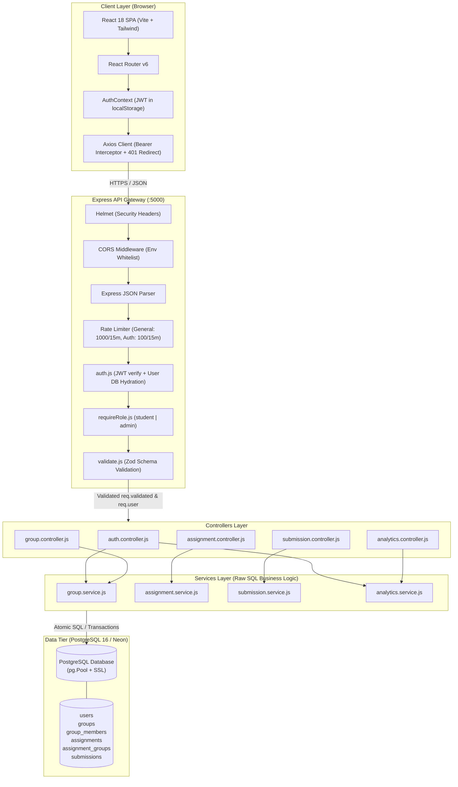
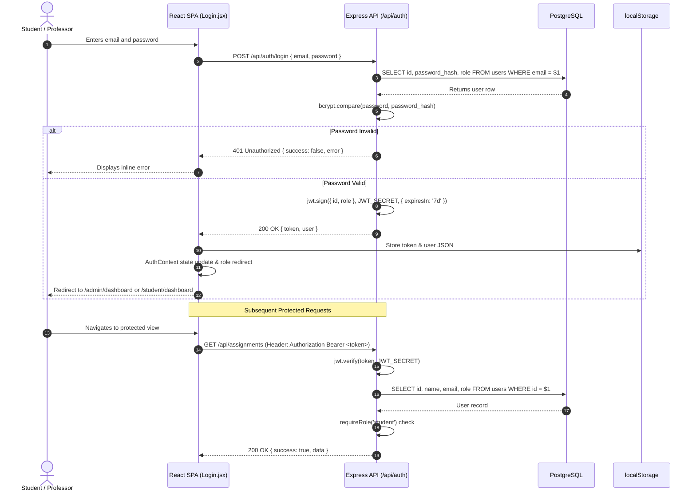
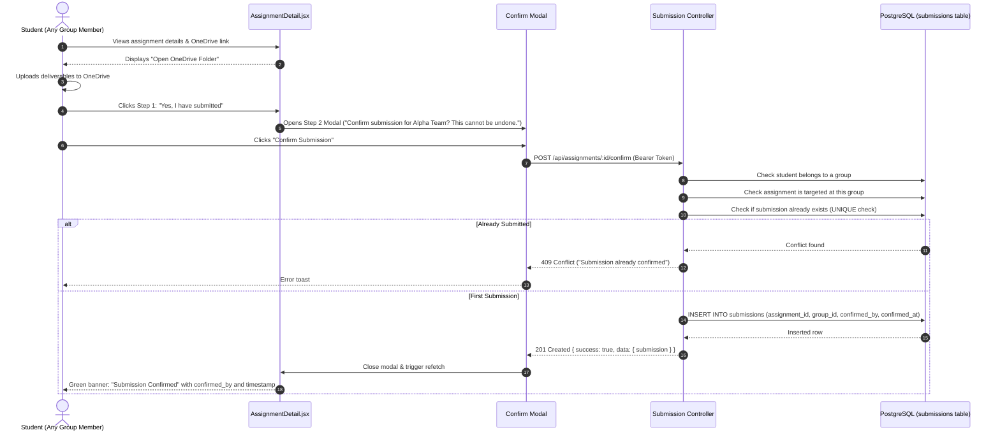

# System Architecture & Technical Specifications

This document describes the end-to-end architecture, request pipeline, security layers, and data workflows of **AssignHub (JoinEazy Assignment Manager)**.

- **Live Frontend Application**: [https://joineazy-assignment-manager.vercel.app/login](https://joineazy-assignment-manager.vercel.app/login)
- **Live Backend API**: [https://joineazy-backend-9pam.onrender.com](https://joineazy-backend-9pam.onrender.com)
- **API Health Endpoint**: [https://joineazy-backend-9pam.onrender.com/api/health](https://joineazy-backend-9pam.onrender.com/api/health)

---

## 1. End-to-End Architecture

---

## 2. JWT Authentication Flow

---

## 3. Two-Step Submission Workflow

---

## 4. Architectural Layer Responsibilities

### 1. Presentation Layer (`frontend/`)
- Built using **React 18** and **Vite** for rapid HMR and optimized tree-shaken builds.
- Styled with **Tailwind CSS v4** design tokens (indigo primary, slate neutrals, rounded-xl cards).
- Visual analytics driven by **Recharts** (donut completion charts, responsive bar charts).
- Fully responsive navigation with off-canvas drawer for mobile screens (375px+).

### 2. API Gateway & Middleware (`backend/src/middleware/`)
- **`helmet`**: Configures strict HTTP security headers.
- **`cors`**: Whitelists frontend origins from environment variables.
- **`rateLimit`**: Enforces general (1000/15min) and sensitive auth rate limits (100/15min) preventing brute force attacks.
- **`auth`**: Decodes and verifies JWT tokens, then hydratres fresh user data from PostgreSQL.
- **`requireRole`**: Declarative role-based access control protecting routes from unauthorized access.
- **`validate`**: Validates incoming payload shapes via **Zod** schemas, short-circuiting malformed requests before touching controllers.
- **`errorHandler`**: Catches synchronous and asynchronous exceptions (`asyncHandler`), mapping `ApiError` instances to uniform JSON envelopes.

### 3. Business Logic & Services (`backend/src/services/`)
- All database queries live strictly inside services using raw SQL queries with parameterized inputs (`$1`, `$2`), completely immunizing the system against SQL injection.
- Zero ORM overhead provides sub-millisecond execution times and deterministic query planning.
- Database transactions (`BEGIN` / `COMMIT` / `ROLLBACK`) ensure atomic operations for group creation and multi-target assignment provisioning.
