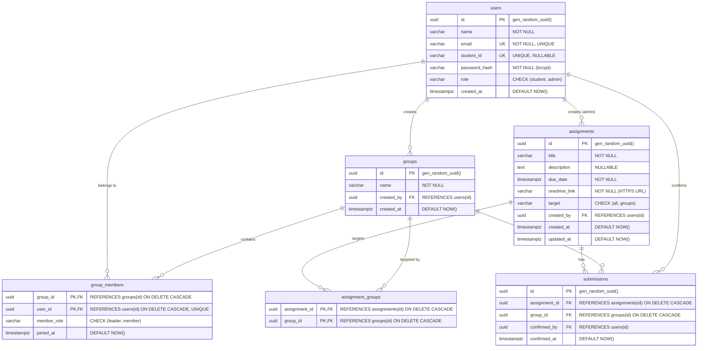

# Database Architecture & Entity-Relationship Model

This document outlines the data model, relational constraints, and indexing strategy for the **JoinEazy Assignment Manager**.

---

## Mermaid ER Diagram



---

## Schema Constraints Matrix

| Table | Constraint Type | Constraint Definition | Business Rule Enforced |
|---|---|---|---|
| `users` | Primary Key | `id UUID PRIMARY KEY DEFAULT gen_random_uuid()` | Universally unique user identifier |
| `users` | Unique Key | `UNIQUE (email)` | One account per university email |
| `users` | Unique Key | `UNIQUE (student_id)` | One account per university student ID (nullable for admin) |
| `users` | Check Constraint | `CHECK (role IN ('student', 'admin'))` | Strict role boundary |
| `groups` | Foreign Key | `created_by REFERENCES users(id)` | Audit trail of group creator |
| `group_members` | Primary Key | `PRIMARY KEY (group_id, user_id)` | Composite identifier for membership |
| `group_members` | **Unique Constraint** | **`UNIQUE (user_id)`** | **Core Rule**: A student can belong to at most **ONE** group |
| `group_members` | Foreign Key | `group_id REFERENCES groups(id) ON DELETE CASCADE` | Deleting a group cascades to all member records |
| `group_members` | Check Constraint | `CHECK (member_role IN ('leader', 'member'))` | Only leader or member roles allowed |
| `assignments` | Check Constraint | `CHECK (target IN ('all', 'groups'))` | Either broadcast to all or targeted to specific groups |
| `assignment_groups` | Primary Key | `PRIMARY KEY (assignment_id, group_id)` | Junction table preventing duplicate targeting |
| `assignment_groups` | Foreign Key | `ON DELETE CASCADE` on both keys | Automatic cleanup on assignment or group deletion |
| `submissions` | **Unique Constraint** | **`UNIQUE (assignment_id, group_id)`** | **Core Rule**: A group can submit an assignment exactly **ONCE** |
| `submissions` | Foreign Key | `confirmed_by REFERENCES users(id)` | Audit trail recording which group member confirmed submission |

---

## Indexing Strategy

Indexes are explicitly defined on all foreign keys, status lookups, and query sorting targets to prevent table scans:

```sql
CREATE INDEX idx_groups_created_by ON groups(created_by);
CREATE INDEX idx_group_members_user_id ON group_members(user_id);
CREATE INDEX idx_group_members_group_id ON group_members(group_id);
CREATE INDEX idx_assignments_created_by ON assignments(created_by);
CREATE INDEX idx_assignments_due_date ON assignments(due_date);
CREATE INDEX idx_assignment_groups_assignment_id ON assignment_groups(assignment_id);
CREATE INDEX idx_assignment_groups_group_id ON assignment_groups(group_id);
CREATE INDEX idx_submissions_assignment_id ON submissions(assignment_id);
CREATE INDEX idx_submissions_group_id ON submissions(group_id);
CREATE INDEX idx_submissions_confirmed_by ON submissions(confirmed_by);
```

- **`idx_group_members_user_id`**: Sub-millisecond lookup for checking student group membership during auth and route access.
- **`idx_assignments_due_date`**: Accelerates deadline sorting and overdue calculation queries.
- **`idx_submissions_assignment_id` & `idx_submissions_group_id`**: Powers real-time analytics aggregation and status tracking queries without sequential scans.
